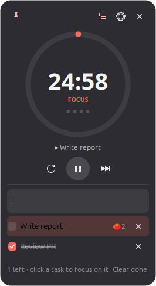

# Promodor

A small floating Pomodoro clock for the Linux desktop. It can float over all your windows, sit on the desktop behind them, or behave like a normal window. You can turn on an optional to-do list in Settings.

<p align="center"></p>

Built with Python and GTK3. It needs no extra packages on a standard Ubuntu install.

## Features

- **Pomodoro timer:** Focus, Short break and Long break sessions. A ring fills as time passes, and dots count your focus sessions.
- **Three window modes:** Always on top, Normal window, or On desktop (below windows).
- **Optional to-do list:** add tasks, tick them off, and pick one as your current task. Each focus session you finish adds a 🍅 to that task.
- **Alerts:** a sound and a desktop notification when a session ends.
- **Auto-start:** breaks and focus sessions can each start on their own.
- **Compact and draggable:** no window border, a see-through background you can adjust, shows on all workspaces, and stays out of the dock by default.
- **Remembers everything:** window position, settings and tasks are kept between runs.

## Requirements

- Linux with an X11 or Wayland session. Tested on Ubuntu 26.04 with GNOME on Wayland.
- Python 3.10 or newer
- GTK3 Python bindings, already installed on Ubuntu. If they're missing:

  ```bash
  sudo apt install python3-gi python3-gi-cairo gir1.2-gtk-3.0
  ```

- Optional: `notify-send` for notifications and `pw-play`, `paplay` or `canberra-gtk-play` for sound.

## Installation

Run it straight from the source folder:

```bash
./promodor.py
```

Or install it for your user. This adds Promodor to the app grid:

```bash
./install.sh
```

To also start it when you log in:

```bash
./install.sh --autostart
```

To uninstall (your settings and tasks are kept):

```bash
./install.sh --uninstall
```

The installer copies these files:

| What | Where |
|---|---|
| App | `~/.local/share/promodor/promodor.py` |
| Launcher | `~/.local/bin/promodor` |
| Desktop entry | `~/.local/share/applications/promodor.desktop` |
| Icon | `~/.local/share/icons/hicolor/scalable/apps/promodor.svg` |
| Autostart (with `--autostart`) | `~/.config/autostart/promodor.desktop` |

## Usage

| Action | How |
|---|---|
| Move the widget | Drag anywhere on it |
| Start / pause | ▶ button, or `Space` |
| Reset the current session | ⟳ button, or `R` |
| Skip to the next session | ⏭ button, or `S` |
| Always on top on/off | 📌 pin button (top left) |
| Show / hide the to-do list | List button, or `T` |
| Open Settings | ⚙ button |
| All actions, switch phase, window mode | Right-click the widget |

Keyboard shortcuts work while the widget has focus and you're not typing in the task box. Press `Esc` to leave the task box.

### Window modes

| Mode | Behaviour |
|---|---|
| **Always on top** | Floats over every window. Good for keeping an eye on the timer. |
| **Normal window** | Stacks like any other window. |
| **On desktop (below windows)** | Stays behind all windows, like a desktop widget. |

### To-do list

1. Open **Settings** and turn on **Enable to-do list**.
2. Type a task in the box and press **Enter**.
3. **Click a task** to make it your current task. It's highlighted and shown under the timer.
4. Each focus session you finish adds a 🍅 to the current task.
5. Tick a task when it's done. If it was the current task, the next unfinished task becomes current. **Clear done** removes all ticked tasks.

## Settings

Change settings in the Settings window; changes apply right away. They are saved to `~/.config/promodor/settings.json`:

| Key | Default | Meaning |
|---|---|---|
| `focus_min` | `25` | Length of a focus session, in minutes |
| `short_min` | `5` | Length of a short break, in minutes |
| `long_min` | `15` | Length of a long break, in minutes |
| `long_every` | `4` | Number of focus sessions before a long break |
| `auto_start_breaks` | `true` | Start the break automatically after a focus session |
| `auto_start_focus` | `false` | Start the next focus session automatically after a break |
| `layer` | `"above"` | Window mode: `above`, `normal` or `below` |
| `all_workspaces` | `true` | Show on every workspace |
| `show_in_taskbar` | `false` | Show in the dock / taskbar and Alt+Tab |
| `todo_enabled` | `false` | Turn on the to-do list |
| `todo_visible` | `true` | Whether the to-do list is expanded |
| `sound` | `true` | Play a sound when a session ends |
| `notify` | `true` | Show a desktop notification when a session ends |
| `opacity` | `0.90` | Background opacity, from `0.3` to `1.0` |

Tasks are saved in `~/.config/promodor/todos.json`.

## How it works on Wayland

GNOME on Wayland doesn't let apps keep their own window above or below other windows. To get around this, Promodor sets `GDK_BACKEND=x11` and runs through **XWayland**, which comes with Ubuntu. That lets it use the standard X11 always-on-top and keep-below window states, which GNOME's window manager respects.

To force native Wayland anyway (window modes won't work), run it like this:

```bash
GDK_BACKEND=wayland ./promodor.py
```

## Troubleshooting

- **Square corners or a black background:** your session isn't compositing. The widget still works but can't be see-through.
- **No sound:** make sure `pw-play` (PipeWire) or `paplay` is installed and that `/usr/share/sounds/freedesktop/stereo/alarm-clock-elapsed.oga` exists.
- **No notification:** install `libnotify-bin` to get `notify-send`, and check that GNOME's Do Not Disturb is off.
- **The widget went off-screen:** delete the `x` and `y` entries from `~/.config/promodor/settings.json` and restart Promodor.
- **Only one copy runs:** this is on purpose. Launching it again brings the existing widget to the front.

## Project layout

```
promodor.py      # the whole app (timer, to-do list, settings dialog)
install.sh       # per-user installer / uninstaller
promodor.svg     # app icon
docs/            # screenshots
```
